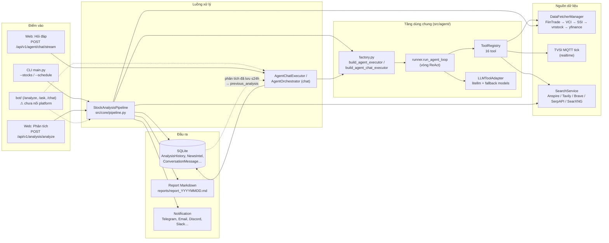
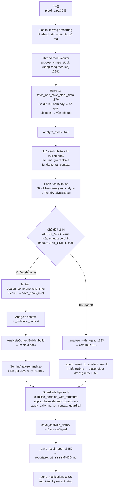
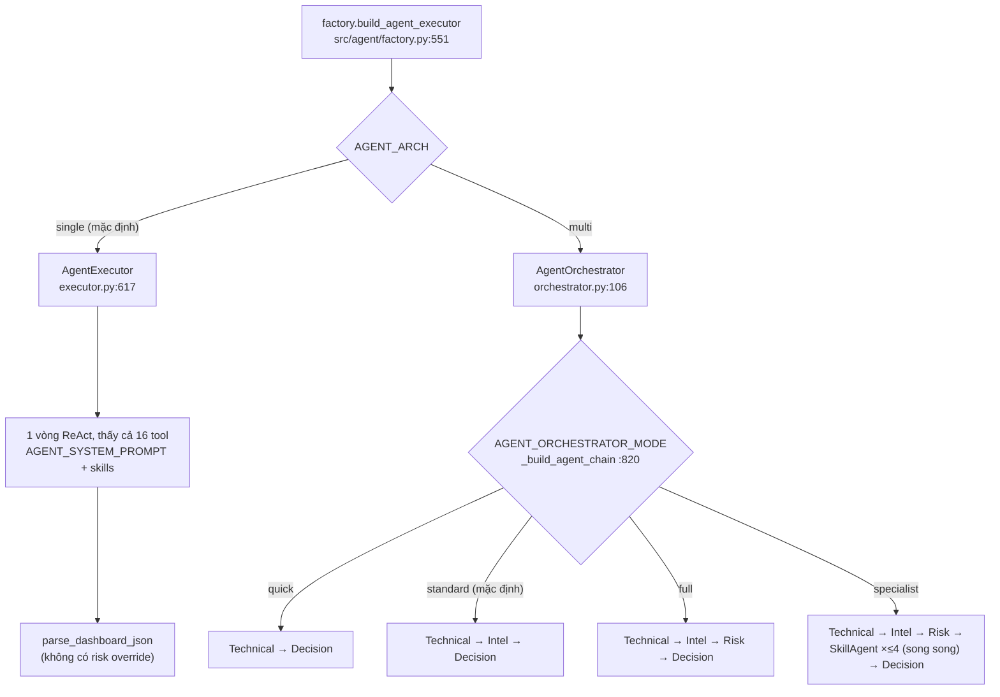
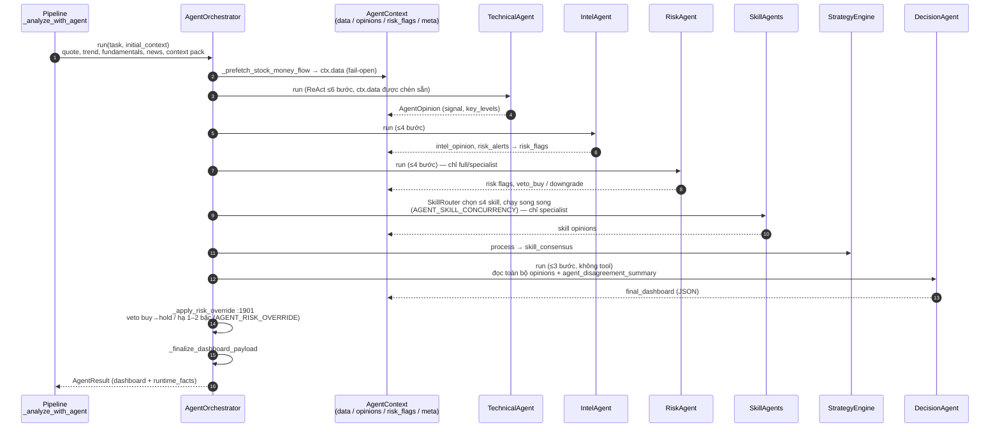
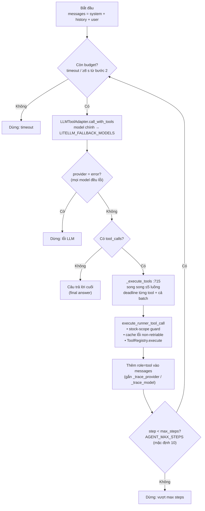
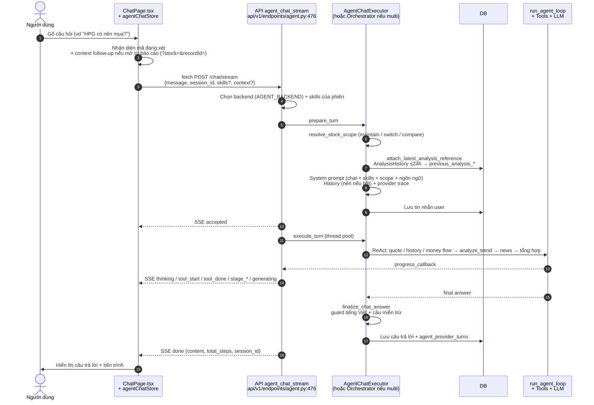

# Workflow Agent — Phân tích mã chứng khoán & Chat hỏi đáp

Tài liệu dùng sơ đồ để mô tả hai luồng chính có sự tham gia của agent/LLM:

- **Phân tích mã** (`StockAnalysisPipeline`): CLI, Web và lịch chạy đều đi qua luồng này.
- **Chat hỏi đáp** (trang `/chat`): người dùng hỏi đáp có ngữ cảnh với agent.

Hai luồng **dùng chung** factory, bộ tool, vòng ReAct và lớp gọi LLM. Chi tiết riêng của chat (API, ngôn ngữ, stock scope, xử lý sự cố) xem [agent-chat.md](agent-chat.md). Hợp đồng sự kiện SSE xem [agent-stream-events.md](agent-stream-events.md).

> Số dòng `file:line` được đối chiếu với code tại thời điểm viết. Nếu lệch, tin vào code.

## 1. Tổng quan kiến trúc

**Ý chính**
- Mọi đường phân tích (CLI `main.py:705`, API sync/async `api/v1/endpoints/analysis.py:312`, bot `/analyze`) đều kết thúc ở `StockAnalysisPipeline.process_single_stock`.
- Chat **không** chạy pipeline. Chat gọi trực tiếp agent, nhưng đọc lại kết quả pipeline đã lưu (`AnalysisHistory` trong vòng 24 giờ) để câu trả lời nhất quán với báo cáo.

## 2. Pipeline phân tích mã

**Ghi chú**
- Agent mode chỉ bật theo các điều kiện ở `pipeline.py:544`. Chỉ có API key thì **không** bật agent mode.
- Agent lỗi thì **không** fallback về legacy: kết quả `success=False` (có trường dự phòng tính từ trend) và mã đó bị loại khỏi báo cáo gộp.
- Lỗi của một mã được bắt trong `process_single_stock`, không làm dừng cả batch.
- Khi `SINGLE_STOCK_NOTIFY` bật, mỗi mã được gửi ngay khi xong và bỏ bước gửi gộp.

## 3. Agent: single hay multi (`AGENT_ARCH`)

Các agent trong chế độ multi (mỗi agent là một `BaseAgent` chạy **vòng ReAct riêng** với tập tool đã lọc):

| Agent | File | max_steps | Tool được dùng | Đầu ra |
| --- | --- | --- | --- | --- |
| Technical | `agents/technical_agent.py` | 6 | quote, daily_history, analyze_trend, calculate_ma, volume, pattern, analysis_context | signal, confidence, key_levels |
| Intel | `agents/intel_agent.py` | 4 | search_stock_news, search_comprehensive_intel, get_stock_info, get_stock_money_flow | intel_opinion, risk_alerts → `ctx.risk_flags` |
| Risk | `agents/risk_agent.py` | 4 | search_stock_news, get_realtime_quote, get_stock_info | risk flags (severity), `veto_buy` / `signal_adjustment` |
| SkillAgent | `skills/skill_agent.py` | 4 | `required_tools` của skill (không khai báo thì dùng tất cả) | ý kiến theo chiến lược |
| Decision | `agents/decision_agent.py` | 3 | **không có tool**, chỉ đọc context | dashboard JSON (pipeline) / câu trả lời (chat) |

## 4. Multi-agent chi tiết (pipeline, `response_mode="dashboard"`)

**Quy tắc phối hợp**
- Các agent chạy **tuần tự** và chia sẻ một `AgentContext` (`src/agent/protocols.py`). Chỉ SkillAgent chạy song song.
- `ctx.data` (dữ liệu nạp sẵn) được chèn vào prompt của mọi agent, mỗi trường tối đa 8000 ký tự. Kết quả tool do agent con gọi **không** được ghi vào `ctx.data`. Vì vậy money flow được nạp sẵn để DecisionAgent cũng thấy.
- Intel, Risk và Skill là stage **không quan trọng**: nếu lỗi thì ghi vào `degraded_stages` và chạy tiếp. Technical hoặc Decision lỗi thì dừng pipeline.
- Hết thời gian (`AGENT_ORCHESTRATOR_TIMEOUT_S`, mặc định 600 s) hoặc còn dưới 15 s trước một stage: trả dashboard **partial** dựng từ các opinion đã có.

## 5. Vòng ReAct `run_agent_loop`

Dùng chung cho single-agent, cho từng agent con trong multi-agent và cho chat (`src/agent/runner.py:326`).

## 6. Chat hỏi đáp

**Ba backend của chat** (`factory.build_agent_chat_executor`, `src/agent/factory.py:626`):

| Cấu hình | Executor | Cách chạy |
| --- | --- | --- |
| `AGENT_BACKEND=auto/litellm`, `AGENT_ARCH=single` (mặc định) | `AgentChatExecutor` + `LiteLLMAgentBackend` | 1 vòng ReAct với cả 16 tool |
| `AGENT_ARCH=multi` | `AgentOrchestrator` (`response_mode="chat"`) | Chuỗi agent như mục 4; DecisionAgent viết câu trả lời dạng văn bản tự do, kèm "ràng buộc rủi ro bắt buộc" lấy từ `build_risk_override_plan` |
| `AGENT_BACKEND=codex_app_server` | `CodexAgentBackend` | Runtime Codex tự điều khiển vòng lặp, chỉ thấy 3 tool an toàn khi huỷ (`get_analysis_context`, backtest summary) |

**Ngữ cảnh làm câu trả lời nhất quán với báo cáo**
- Web gửi `previous_analysis_summary` khi người dùng hỏi tiếp từ một báo cáo. Nếu không có, backend tự gắn báo cáo gần nhất của mã trong 24 giờ (`src/agent/chat_context.py:510`). Lỗi DB thì bỏ qua (fail-open).
- Single-agent nhận ngữ cảnh này dưới dạng cặp tin nhắn user/assistant tổng hợp. Multi-agent nhận qua `ctx.meta["previous_analysis"]`.
- Stock scope (`src/agent/stock_scope.py:207`) chặn agent gọi tool cho mã ngoài phạm vi đang hỏi.

## 7. Bảng tool (16 tool, `factory._build_tool_registry` :350)

| Nhóm | Tool | Mục đích | Nguồn dữ liệu | Agent dùng (multi) |
| --- | --- | --- | --- | --- |
| data | `get_realtime_quote` | Giá, %, KL, P/E, P/B, vốn hoá, khối ngoại phiên | TVSI MQTT → FiinTrade/SSI/VCI (`REALTIME_SOURCE_PRIORITY`) | Technical, Risk |
| data | `get_stock_money_flow` | Khối ngoại / tự doanh: hôm nay, 1W, 1M, YTD | FiinTrade | Intel (+ nạp sẵn) |
| data | `get_daily_history` | OHLCV N ngày | DB cache → fetchers | Technical |
| data | `get_analysis_context` | Ngữ cảnh phân tích đã lưu | DB | Technical |
| data | `get_stock_info` | Định giá + cơ bản rút gọn | `get_fundamental_context` | Intel, Risk |
| data | `get_portfolio_snapshot` | Tóm tắt danh mục + rủi ro | PortfolioService | — (single/portfolio) |
| analysis | `analyze_trend` | MA, MACD, RSI, KL, hỗ trợ/kháng cự, điểm mua | `StockTrendAnalyzer` | Technical |
| analysis | `calculate_ma` | MA theo chu kỳ tuỳ chọn | lịch sử giá | Technical |
| analysis | `get_volume_analysis` | Phân tích khối lượng | lịch sử giá | Technical |
| analysis | `analyze_pattern` | Nhận diện mô hình nến | lịch sử giá | Technical |
| search | `search_stock_news` | Tin mới nhất (≤5) | SearchService | Intel, Risk |
| search | `search_comprehensive_intel` | Tìm nhiều chiều | SearchService | Intel |
| market | `get_market_indices` | VN-Index, VN30, HNX, UPCoM | DataFetcherManager | — |
| backtest | `get_skill_backtest_summary` | Backtest theo skill | BacktestService | — |
| backtest | `get_strategy_backtest_summary` | Backtest chiến lược tổng | BacktestService | — |
| backtest | `get_stock_backtest_summary` | Backtest theo mã | BacktestService | — |

Single-agent (cả pipeline và chat) thấy toàn bộ 16 tool.

## 8. Thành phần dùng chung giữa Pipeline và Chat

| Dùng chung | Chỉ Pipeline | Chỉ Chat |
| --- | --- | --- |
| `factory.py`, `ToolRegistry`, `run_agent_loop`, `LLMToolAdapter`, `SkillManager` (`strategies/*.yaml`), các agent chuyên trách, `build_risk_override_plan`, `DataFetcherManager`, `SearchService`, `StockTrendAnalyzer` | `GeminiAnalyzer` (legacy), context pack, guardrails hậu xử lý, report, notification, `AgentExecutor.run` + `parse_dashboard_json` | `prepare_agent_chat`, `AgentChatExecutor`, stock scope, prompt chat, `finalize_chat_answer`, lưu hội thoại + provider trace, SSE |

## 9. Cờ cấu hình quyết định luồng

| Biến | Mặc định | Tác dụng |
| --- | --- | --- |
| `AGENT_MODE` | `false` | Pipeline dùng agent thay vì `GeminiAnalyzer` (skills trong request hoặc `AGENT_SKILLS` cũng bật agent mode) |
| `AGENT_ARCH` | `single` | `single`: 1 vòng ReAct; `multi`: `AgentOrchestrator` |
| `AGENT_ORCHESTRATOR_MODE` | `standard` | `quick` / `standard` / `full` / `specialist` (chỉ khi `multi`) |
| `AGENT_BACKEND` | `auto` | Backend của chat: `auto`/`litellm` hoặc `codex_app_server` |
| `AGENT_MAX_STEPS` | `10` | Số bước tối đa của vòng ReAct (single-agent / chat) |
| `AGENT_ORCHESTRATOR_TIMEOUT_S` | `600` | Tổng thời gian cho một lượt multi-agent |
| `AGENT_RISK_OVERRIDE` | `true` | Áp veto/hạ bậc tín hiệu theo RiskAgent (chỉ multi-agent) |
| `AGENT_MEMORY_ENABLED` | `false` | Chèn 3 phân tích gần nhất và kết quả của chúng vào prompt từng agent (multi) |
| `AGENT_CONTEXT_COMPRESSION_ENABLED` | `false` | Nén lịch sử chat cũ bằng LLM |
| `AGENT_LITELLM_MODEL` / `LITELLM_MODEL` / `LITELLM_FALLBACK_MODELS` | — | Model chính và chuỗi model fallback |

Giải thích đầy đủ xem `.env.example`.

## 10. Lưu ý dễ hiểu nhầm

- **Agent lỗi không fallback về legacy.** Mã đó sẽ có `success=False` và không xuất hiện trong báo cáo gộp.
- **Single-agent không có risk override.** Veto/hạ bậc chỉ chạy trong `AgentOrchestrator`.
- **Bot chưa hoạt động như một kênh nhận lệnh:** `bot/platforms/__init__.py` có `ALL_PLATFORMS = {}` và không route API nào gọi webhook. Telegram, Discord và Slack hiện chỉ dùng làm kênh **gửi** thông báo.
- **Không có thư mục `src/reports/`.** Report được dựng trong `src/notification.py` và `src/services/report_renderer.py` (template `templates/report_*.j2`).
