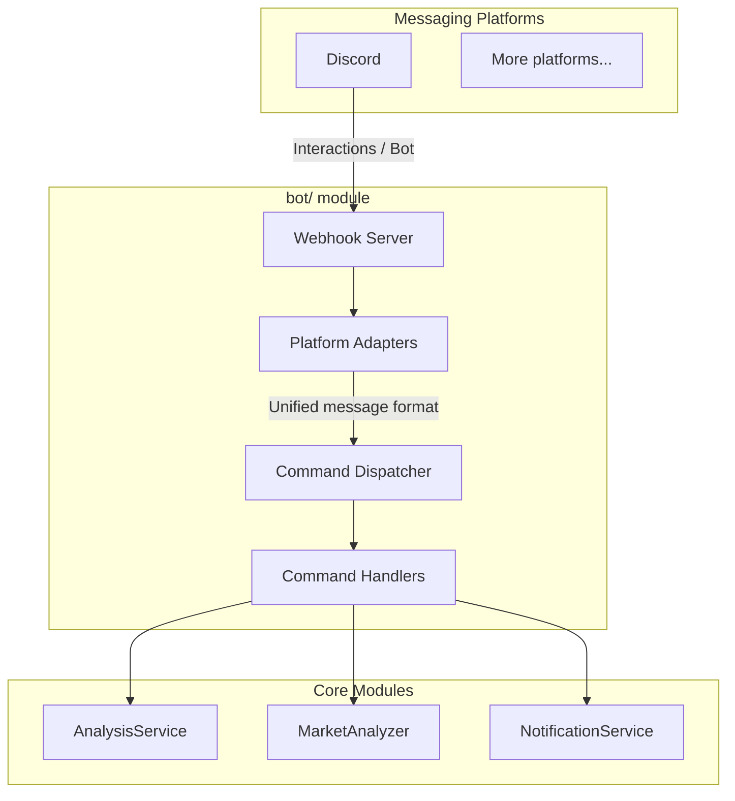

# Bot Integration Guide

This document covers the bot module architecture, supported commands, webhook routes, and how to configure platform integrations.

> **Glossary:** "Enterprise bot" in this context means a chatbot that receives commands via webhook from a messaging platform (currently Discord) and calls the analysis pipeline to reply inline.

---

## 1. Architecture Overview



---

## 2. Directory Structure

```
bot/
├── __init__.py             # Module entry, exports main classes
├── models.py               # Unified message/response models
├── dispatcher.py           # Command dispatcher (core)
├── handler.py              # Webhook handler functions (one per platform)
├── commands/               # Command handlers
│   ├── __init__.py
│   ├── base.py             # Abstract base class for commands
│   ├── analyze.py          # /analyze — stock/index analysis
│   ├── ask.py              # /ask — single-turn question
│   ├── batch.py            # /batch — batch watchlist analysis
│   ├── chat.py             # /chat — multi-turn strategy chat
│   ├── market.py           # /market — market review
│   ├── help.py             # /help — help text
│   └── status.py           # /status — system status
└── platforms/              # Platform adapters
    ├── __init__.py
    ├── base.py             # Abstract base class for platforms
    └── discord.py          # Discord bot
```

---

## 3. Core Abstractions

### 3.1 Unified Message Model (`bot/models.py`)

```python
@dataclass
class BotMessage:
    platform: str       # Platform ID, e.g. discord
    user_id: str        # Sender ID
    user_name: str      # Sender display name
    chat_id: str        # Conversation ID (group or DM)
    chat_type: str      # Conversation type: group / private
    content: str        # Message text
    raw_data: Dict      # Raw request data (platform-specific)
    timestamp: datetime
    mentioned: bool = False  # Whether the bot was @-mentioned

@dataclass
class BotResponse:
    text: str
    markdown: bool = False  # Whether the response is Markdown
    at_user: bool = True    # Whether to @-mention the sender
```

### 3.2 Platform Adapter Base (`bot/platforms/base.py`)

```python
class BotPlatform(ABC):
    @property
    @abstractmethod
    def platform_name(self) -> str: ...

    @abstractmethod
    def verify_request(self, headers: Dict, body: bytes) -> bool:
        """Verify request signature (security check)"""
        ...

    @abstractmethod
    def parse_message(self, data: Dict) -> Optional[BotMessage]:
        """Parse platform message into unified format"""
        ...

    @abstractmethod
    def format_response(self, response: BotResponse, message: BotMessage) -> WebhookResponse:
        """Convert unified response to platform format"""
        ...
```

### 3.3 Command Base Class (`bot/commands/base.py`)

```python
class BotCommand(ABC):
    @property
    @abstractmethod
    def name(self) -> str: ...          # e.g. 'analyze'

    @property
    @abstractmethod
    def aliases(self) -> List[str]: ... # e.g. ['a', 'analyse']

    @property
    @abstractmethod
    def description(self) -> str: ...

    @property
    @abstractmethod
    def usage(self) -> str: ...

    @abstractmethod
    def execute(self, message: BotMessage, args: List[str]) -> BotResponse: ...
```

---

## 4. Supported Commands

| Command | Description | Example |
|---------|-------------|---------|
| `/analyze` | Analyze a specific stock or a registered index | `/analyze HPG`, `/analyze VNINDEX`, `/analyze FPT.VN` |
| `/ask` | Single-turn question about a stock or the market | `/ask what is RSI for HPG` |
| `/batch` | Batch-analyze your configured watchlist | `/batch` |
| `/chat` | Multi-turn strategy chat (maintains conversation context) | `/chat` |
| `/market` | Vietnam market review | `/market` |
| `/help` | Show help text | `/help` |
| `/status` | Show system status | `/status` |

> **Stock code formats:** Vietnam codes only — bare `HPG`, suffix `HPG.VN`, prefix `vnHPG`, fund certificates such as `FUEVN100`, and indices such as `VNINDEX` / `VN30` / `HNXIndex`. Non-Vietnam codes (e.g. `600519`, `hk00700`, `AAPL`) return an explicit error without submitting a task. See [market scope](market-support.md) (Vietnamese).

---

## 5. `/status` and LLM configuration diagnostics

### Configuration precedence for readiness in `/status`

- The AI availability displayed by `/status` follows runtime precedence:
  - `LITELLM_CONFIG` (LiteLLM YAML)
  - `LLM_CHANNELS`
  - legacy provider keys (`GEMINI_API_KEY` / `OPENAI_API_KEY` / `ANTHROPIC_API_KEY` / `DEEPSEEK_API_KEY`)
- If the primary model (`LITELLM_MODEL` or `AGENT_LITELLM_MODEL`) has no configured source in the active layer, `/status` shows `AI 服务未配置` and keeps the explicit reason line.
- Runtime dependency constraint in this repository is `litellm>=1.80.10,!=1.82.7,!=1.82.8,<1.99.0`; current status semantics are aligned with this constraint.
- This diagnostic follows the same readiness rules as `GET /api/v1/system/config/setup/status` for LLM checks: channels/yaml are active higher priority than legacy keys, and no silent migration is performed when toggling modes.

### Fallback and migration boundary

- When `LITELLM_CONFIG` or `LLM_CHANNELS` is active, lower-priority legacy provider keys are ignored as the active source for that run (no silent downgrade).
- This change only improves diagnosis and does not perform automatic migration: legacy configuration values are not deleted or rewritten during startup or status collection.

### Official compatibility references (for triage)

- LiteLLM docs: https://docs.litellm.ai/
- LiteLLM OpenAI-compatible provider: https://docs.litellm.ai/docs/providers/openai_compatible
- OpenAI Chat API: https://platform.openai.com/docs/api-reference/chat
- DeepSeek API docs: https://api-docs.deepseek.com/
- Kimi Moonshot compatibility: https://platform.moonshot.ai/docs/guide/compatibility
- Gemini OpenAI compatibility: https://ai.google.dev/gemini-api/docs/openai
- Ollama API docs: https://github.com/ollama/ollama/blob/main/docs/api.md

## 6. Webhook Routes

Handler functions for each platform live in `bot/handler.py`; the only remaining platform adapter is Discord (see [Discord bot setup](bot/discord-bot-config.md)). Feishu, DingTalk and WeChat Work adapters have been removed.

---

## 7. Configuration

Add the following to your `.env` (see `.env.example` for the full list):

```dotenv
# --- Bot general ---
BOT_ENABLED=false
BOT_COMMAND_PREFIX=/

# --- Discord bot ---
DISCORD_BOT_TOKEN=
DISCORD_MAIN_CHANNEL_ID=
DISCORD_INTERACTIONS_PUBLIC_KEY=
```

---

## 7. Extending the Bot

### Adding a new platform adapter

1. Create a new file in `bot/platforms/`.
2. Subclass `BotPlatform` and implement `verify_request`, `parse_message`, `format_response`.
3. Mount the webhook route directly in your FastAPI app (for example in `api/app.py`) instead of `api/v1/router.py`, so the callback path stays `/bot/<platform>` rather than `/api/v1/bot/<platform>`.

### Adding a new command

1. Create a new file in `bot/commands/`.
2. Subclass `BotCommand` and implement the `execute` method.
3. Register the command in the dispatcher startup code.
