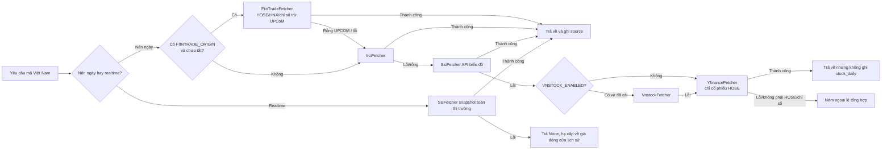

# Độ ổn định nguồn dữ liệu và xử lý sự cố

Tài liệu cho người dùng, người triển khai và người bảo trì: các nguồn dữ liệu thị trường Việt Nam tham gia phân tích và điểm lại thị trường như thế nào, và hệ thống hạ cấp ra sao khi một nguồn lỗi.

Hệ thống chỉ hỗ trợ thị trường Việt Nam (xem [Phạm vi thị trường](market-support.md)). Các nguồn A-share / quốc tế (akshare, efinance, tushare, pytdx, baostock, tencent, tickflow, longbridge, futu, finnhub, alphavantage) đã bị xoá; biến môi trường của chúng bị bỏ qua.

## Trả lời người dùng trong một câu

"Lỗi nguồn dữ liệu" thường là do API công khai bị giới hạn tần suất, thay đổi tạm thời phía upstream hoặc mạng chập chờn, không phải hệ thống chỉ có một nguồn. Chuỗi mặc định VCI → SSI → (vnstock tuỳ chọn) → Yahoo tự chuyển sang nguồn kế tiếp; cả ba nguồn mặc định đều là API công khai, **không cần API key**.

## Ma trận nguồn dữ liệu

| Tình huống | Nguồn | Cách dùng mặc định | Xử lý khi lỗi |
| --- | --- | --- | --- |
| Nến ngày cổ phiếu / kỹ thuật | FiinTrade (tuỳ chọn), VCI (Vietcap), SSI iBoard, vnstock (tuỳ chọn), Yahoo (chỉ HOSE) | `DataFetcherManager` thử theo priority: FiinTrade(P-1, nếu bật) → VCI(P0) → SSI(P1) → vnstock(P2, nếu bật) → Yahoo(P4) | Lỗi thì sang nguồn kế; lỗi liên tiếp sẽ ngắt mạch nguồn đó một thời gian ngắn; tất cả đều lỗi thì ném ngoại lệ tổng hợp |
| Giá realtime | FiinTrade PriceDepth (tuỳ chọn, đứng đầu khi bật), SSI iBoard (VCI là lựa chọn thứ hai qua `REALTIME_SOURCE_PRIORITY`), TVSI MQTT (tuỳ chọn) | Snapshot toàn thị trường (HOSE/HNX/UPCoM mỗi sàn một request), tra từng mã trúng cache trong tiến trình | Snapshot lỗi thì trả `None` và hạ cấp về giá đóng cửa lịch sử; một sàn lỗi không ảnh hưởng hai sàn còn lại |
| Nến ngày chỉ số | VCI (Vietcap) | `VNINDEX` / `VN30` / `VN100` / `HNXIndex` / `HNX30` / `HNXUpcomIndex`, dùng cùng API nến ngày với cổ phiếu | Lỗi thì sang SSI. **Yahoo không tham gia** vì không có lịch sử chỉ số Việt Nam |
| Điểm lại thị trường | FiinTrade (chỉ số, độ rộng, dòng tiền khối ngoại/tự doanh; khi có origin), VCI (chỉ số), SSI (độ rộng thị trường) | `MARKET_REVIEW_REGION=vn` | FiinTrade lỗi thì chuyển sang VCI/SSI; một chỉ số lỗi chỉ bỏ qua chỉ số đó; độ rộng lỗi thì báo cáo thiếu khối độ rộng; dòng tiền lỗi thì bỏ mục Fund Flows |

## Chuỗi hạ cấp



⚠️ **Đơn vị giá**: nến ngày VCI và snapshot SSI dùng "đồng" (HPG báo `21300`), API biểu đồ SSI và `vnstock` dùng "nghìn đồng" (báo `21.3`); hai nguồn sau được nhân 1000 khi chuẩn hoá. Sai đơn vị **không ném lỗi** mà làm MA, % thay đổi và giá cắt lỗ lệch 1000 lần, vì vậy `tests/test_vn_source_drift.py` kiểm tra độ khớp giá đóng cửa giữa các nguồn và độ lớn tuyệt đối, chạy định kỳ cùng `network-smoke`.

### FiinTrade (tuỳ chọn, đứng trước VCI)

API biểu đồ `GET wlgw-technical.fiintrade.vn/TradingView/GetStockChartData` chỉ trả dữ liệu khi header `Origin` nằm trong whitelist của đối tác (không có thì 403). Vì vậy fetcher **mặc định bật nhưng chỉ chạy khi có `FIINTRADE_ORIGIN`**; tắt hẳn bằng `FIINTRADE_ENABLED=false`. Repo không chứa origin cụ thể nào, nên máy chưa điền origin vẫn chạy chuỗi VCI → SSI như cũ. Chỉ dùng khi tổ chức của bạn được FiinTrade cho phép gọi API từ máy chủ.

Đo thực tế (2026-10-21, 263 phiên từ 2025-10-01, so với VCI):

| Mã | Close | Volume | Ghi chú |
| --- | --- | --- | --- |
| FPT (HOSE) | Trùng 100% | Lệch < 1% ở 13 phiên | FiinTrade có vẻ gồm cả lô lẻ |
| PVS (HNX) | Trùng 100% | Lệch ±1% | |
| VNINDEX / HNXIndex | Trùng 100% | Thấp hơn ~10-15% | FiinTrade chỉ tính khớp lệnh |
| UpcomIndex | **Lệch** (16/10: 124.87 vs 125.97) | Lệch | **Không lấy từ FiinTrade**, để VCI phục vụ |
| Mã UPCOM (ACV, BSR, VEA...) | Không có | | API trả `status=Failed`; fetcher trả rỗng nên manager sang VCI **mà không ngắt mạch** FiinTrade |

- Giá đã điều chỉnh quyền và trùng cơ sở với VCI, nên nến ngày **được ghi** `stock_daily` (khác Yahoo). Trường `rateAdjusted` khác 0 tại ngày GDKHQ.
- API không có giá trị giao dịch, giá tham chiếu hay trần/sàn: `amount` được ước lượng bằng `(high+low)/2 × volume` (giống API biểu đồ SSI).
- Nến hôm nay trong phiên là nến dở (`tradingDate` có kèm giờ). Fetcher quy về ngày giao dịch; tầng phân tích vẫn xử lý nến dở như với VCI.
- Volume chỉ số thấp hơn VCI. Nếu một ngày FiinTrade lỗi và VCI bù vào, `volume_ratio` của chỉ số ngày đó có thể cao hơn thực tế khoảng 10-15%.

#### Giá trong phiên và định giá (`PriceDepth/GetPriceDepth`)

Khi bật, FiinTrade đứng đầu chuỗi giá realtime (token `fiintrade` trong `REALTIME_SOURCE_PRIORITY`; không ghi thì tự đứng đầu, ghi rõ vị trí thì giữ đúng vị trí). Tick TVSI MQTT vẫn được dùng trước nếu còn mới. Chỉ có cổ phiếu HOSE/HNX: chỉ số rơi sang VCI, mã UPCOM rơi sang SSI.

Ngoài giá/OHLC/khối lượng/giá trị khớp, nguồn này điền thêm: giá tham chiếu/trần/sàn, giao dịch thoả thuận, khối ngoại mua/bán/ròng, room ngoại còn lại, tỷ lệ sở hữu nước ngoài, tỷ lệ dư mua 3 bước giá, KL bình quân 1 tháng và các chỉ tiêu định giá. Các chỉ tiêu định giá nằm trong `extraInfo` dưới dạng mã nội bộ, ý nghĩa được **suy ra** bằng đối chiếu chéo:

| Mã | Ý nghĩa | Kiểm chứng |
| --- | --- | --- |
| `rtd11` | Vốn hoá (VND) → `total_mv` | FPT 108.240 tỷ = 57.400 × ~1,886 tỷ CP |
| `rtd14` | EPS 4 quý → `eps_ttm` | giá / `rtd14` = `rtd21` |
| `rtd21` | P/E → `pe_ratio` | FPT 10,78 |
| `rtd25` | P/B → `pb_ratio` | |
| `rtq12` | ROE (tỷ lệ) → `roe` (%) | FPT 26,5% |
| `rtd35` | Beta (ước đoán) → `beta` | TCB 1,14 / FPT 0,67 / HPG 1,03 |

- `turnover_rate` tính trên **tổng số cổ phiếu** (= vốn hoá / giá), không phải free-float; `circ_mv` và `volume_ratio` để trống.
- Khối định giá trong `fundamental_context` lấy thẳng từ FiinTrade (tick MQTT và snapshot SSI không có định giá), nên P/E, P/B, vốn hoá trong prompt không còn N/A với mã HOSE/HNX.

#### Cổ tức và sự kiện doanh nghiệp (`TradingView/GetStockEvents`)

- **`exrightDate` là ngày đăng ký cuối cùng**, không phải ngày GDKHQ: nó luôn đứng sau ngày có `rateAdjusted` của API biểu đồ đúng một phiên. Fetcher suy ra GDKHQ = ngày làm việc liền trước (chưa trừ ngày lễ vì repo chưa có lịch nghỉ lễ). Với FPT, GDKHQ suy ra (28/11/2025, 27/05/2026, 18/09/2026) trùng đúng ngày điều chỉnh giá.
- Khối `earnings` (`partial`, vì chưa có báo cáo tài chính): cổ tức tiền mặt 12 tháng theo GDKHQ (`ttm_cash_dividend_per_share`, lợi suất theo giá hiện tại, số đợt), phát hành/thưởng 365 ngày, 4 kỳ công bố KQKD gần nhất. Số liệu `revenue`/`profit` của sự kiện `Earning` **không dùng** vì chưa rõ là loại lợi nhuận nào.
- Khối `institution`: giao dịch nội bộ 90 ngày (tối đa 10 dòng, cộng KL ròng đã thực hiện), tỷ lệ sở hữu và room ngoại.
- Mã UPCOM trả danh sách rỗng vì không được phủ: hai khối trên thành `not_supported` thay vì báo "cổ tức = 0".
- Sự kiện được cache theo mã 6 giờ. Lỗi API chỉ làm hai khối này `failed`, khối định giá không bị ảnh hưởng.

#### Điểm lại thị trường (máy chủ `wlgw-market.fiintrade.vn`)

| Endpoint | Dùng cho | Ghi chú |
| --- | --- | --- |
| `MarketInDepth/GetLatestIndices` | Chỉ số chính + độ rộng | 29 chỉ số trong một request (~0,3s), cache 30 giây để chỉ số và độ rộng dùng chung |
| `MoneyFlow/GetForeign?ComGroupCode=VNINDEX` | Khối ngoại HOSE theo kỳ | ~3s; cache 5 phút |
| `MoneyFlow/GetProprietaryV2?ComGroupCode=VNINDEX` | Tự doanh HOSE theo kỳ | ~1,5s; cache 5 phút; top list lọc bỏ chứng quyền |

Đối chiếu ngày 21/10/2026:
- VNINDEX/VN30/HNX-Index trùng SSI và VCI.
- Giá trị chỉ số của VCI đúng bằng khớp lệnh + thoả thuận của FiinTrade (VNINDEX 20.290 = 17.071 + 3.219 tỷ), nên `amount` chỉ số giữ đúng ngữ nghĩa cũ.
- Độ rộng 3 sàn: FiinTrade 458 tăng / 225 giảm / 187 đứng, trần 43 / sàn 26, khớp lệnh 18.696 tỷ; SSI 478 / 232 / 190, 45 / 27, 18.767 tỷ (SSI đếm cả ETF).

Lưu ý ngữ nghĩa:
- Khối ngoại ròng = mua − bán. Trường `foreignNetBuyValue` ở khối tổng là **tổng các mã mua ròng**, không phải ròng thị trường.
- Tự doanh công bố sau phiên. Khoảng ngày của kỳ mới nhất đổi theo thời điểm gọi: trong phiên là phiên trước (20/10 → 20/10), sau khi công bố lại gộp hai phiên (20/10 → 21/10). Vì vậy prompt luôn kèm khoảng ngày và dặn model không gọi đó là "hôm nay".
- Kỳ "1 tuần" của khối ngoại kết thúc ở phiên trước, không gồm hôm nay.

### Vai trò của Yahoo Finance (dự phòng thứ ba)

Yahoo cung cấp dữ liệu Việt Nam qua hậu tố `.VN` và chỉ được gọi khi cả VCI lẫn SSI đều lỗi. Lý do giữ lại: hạ tầng của Yahoo nằm ngoài Việt Nam, che được trường hợp các API công khai trong nước cùng lúc không truy cập được.

Độ phủ đo thực tế (2026-09-21, 20 mẫu ngẫu nhiên mỗi sàn):

| Sàn | Độ phủ | Ghi chú |
| --- | --- | --- |
| HOSE | 20/20 | `HPG.VN`, `FPT.VN`..., giá tính bằng đồng |
| HNX | **0/20** | Mọi kiểu hậu tố (`.HN` / `.HNX` / `.VN` / `.HA`) đều rỗng |
| UPCoM | **0/20** | Chỉ vài mã vốn hoá lớn (ví dụ `MCH.VN`) có dữ liệu |
| Chỉ số | **Không dùng được** | `^VNINDEX.VN` hỏi một năm chỉ trả 1 nến; `^VN30.VN` / `^HNXINDEX.VN` / `^UPCOM.VN` rỗng |

Vì vậy `data_capability_service` chỉ khai báo `kline.daily` cho Yahoo, không khai báo `quote.realtime`, `index.daily` hay `market.overview`; khi hỏi chỉ số Việt Nam, `_convert_stock_code` ném `DataFetchError` ngay mà không gửi request.

⚠️ **Mốc điều chỉnh giá khác nhau nên nến ngày Yahoo không ghi DB**: `save_daily_data` UPSERT theo `(code, date)`, nhưng Yahoo và VCI điều chỉnh quyền khác nhau. Ví dụ MBB (82 phiên): sau 2026-08-11 hai nguồn khớp hoàn toàn, còn trước 2026-07-09 lệch hệ số cố định **1.043938** — đó là bậc thang tại ngày giao dịch không hưởng quyền, không phải nhiễu. Ghi lẫn hai nguồn sẽ tạo khoảng trống giả ~4.4%, làm MA, tỷ lệ khối lượng và hỗ trợ/kháng cự sai lệch mà không báo lỗi. `should_persist_daily_data()` (`data_provider/base.py`) chặn việc ghi này: nến ngày từ Yahoo chỉ phục vụ lần phân tích hiện tại, dựng ngữ cảnh trong bộ nhớ qua `_build_analysis_context_from_daily_df()`.

⚠️ **Đừng đặt `YFINANCE_PRIORITY` trước `SSI_PRIORITY`**: Yahoo thiếu HNX, UPCoM và toàn bộ chỉ số; dùng làm nguồn chính sẽ khiến hàng loạt mã lỗi.

⚠️ **Không có lịch giao dịch**: `exchange-calendars` không có HOSE/HNX/UPCoM; kiểm tra ngày giao dịch chỉ loại thứ Bảy / Chủ nhật (fail-open), nên dịp nghỉ lễ dài vẫn gửi request.

## Hợp đồng chỉ đọc về năng lực dữ liệu

Web/API cung cấp `GET /api/v1/data/overview` (bí danh `GET /api/v1/data/capabilities`) để trình bày năng lực nguồn, chất lượng tập dữ liệu và thứ tự ưu tiên theo một cấu trúc chỉ đọc. Endpoint chỉ đọc cấu hình và snapshot fetcher của `DataFetcherManager`, không gọi API thị trường và không trả về khoá bí mật.

- `providers`: `enabled`, `configured`, `status`, `markets`, `datasets`, `dataset_markets` và cảnh báo không nhạy cảm của từng provider.
- `datasets`: `status/source/fallback_from/stale/warnings` của `quote.realtime`, `kline.daily`, `index.daily`, `market.overview`, `news.events`, `alert.monitor`, `portfolio.account`...
- `priorities`: thứ tự nguồn hiện tại theo từng tình huống.

`unknown` nghĩa là chưa thăm dò lúc chạy, `unconfigured` nghĩa là thiếu cấu hình bắt buộc, `degraded` nghĩa là nguồn ưu tiên trước không dùng được nhưng nguồn sau vẫn phục vụ.

## Cấu hình khuyến nghị

Không cần cấu hình gì để chạy: VCI + SSI là mặc định. Các tuỳ chọn trong `.env.example`:

```env
# Thứ tự priority (số nhỏ hơn được thử trước)
# VCI_PRIORITY=0
# SSI_PRIORITY=1
# Thứ tự nguồn giá realtime (token: ssi / vci)
# REALTIME_SOURCE_PRIORITY=ssi
# FiinTrade: mặc định bật khi có origin trong whitelist của FiinTrade, đứng trước VCI
# FIINTRADE_ORIGIN=
# FIINTRADE_ENABLED=true
# vnstock tuỳ chọn: chỉ bật khi chấp nhận giấy phép Personal Use và telemetry của vnstock
# pip install -r requirements-vn-optional.txt
# VNSTOCK_ENABLED=false
```

## Gợi ý thông điệp cho người dùng

| Tình huống | Thông điệp gợi ý |
| --- | --- |
| Một nguồn lỗi nhưng fallback thành công | Lần này dùng nguồn dự phòng, phân tích vẫn tiếp tục; báo cáo ghi rõ nguồn đã dùng. |
| Nhiều nguồn lỗi nhưng còn cache | Nguồn realtime không khả dụng, dùng dữ liệu thành công gần nhất; độ tin cậy kết luận giảm. |
| Mọi nguồn đều lỗi và không có cache | Dữ liệu hiện không khả dụng, vui lòng thử lại sau; kiểm tra kết nối tới `trading.vietcap.com.vn` và `iboard-query.ssi.com.vn`. |

### Ghi chú báo cáo khi thiếu bằng chứng tin tức (đã triển khai)

Báo cáo phân biệt **chưa tìm kiếm tin** với **đã tìm nhưng không có kết quả** và hiển thị cảnh báo tương ứng ở dashboard, brief, báo cáo từng mã, báo cáo ngày, Markdown lịch sử, ảnh chia sẻ và chi tiết báo cáo trên Web; báo cáo tiếng Việt và tiếng Anh dùng câu chữ riêng. Cảnh báo không phụ thuộc đầu ra của mô hình: dù LLM vẫn viết `market_sentiment` / `hot_topics`, hễ tìm kiếm không có kết quả là vẫn cảnh báo.

Căn cứ là `AnalysisResult.news_result_count`:

| Giá trị | Ý nghĩa | Có cảnh báo |
| --- | --- | --- |
| `None` | Chưa tìm kiếm (chưa cấu hình kênh tìm kiếm) | **Có** |
| `0` | Đã tìm nhưng không có kết quả (bị giới hạn, mọi nguồn lỗi...) | **Có** |
| `> 0` | Có tin tức | Không |

Bản ghi mới lưu giá trị ba trạng thái này cùng kết quả phân tích; bản ghi cũ không có trường này được coi là "không rõ" và giữ nguyên cách hiển thị.

## Tài liệu chính thức

- Vietcap (VCI): https://trading.vietcap.com.vn/
- SSI iBoard: https://iboard.ssi.com.vn/
- vnstock (giấy phép): https://vnstocks.com/onboard/giay-phep-su-dung
- Yahoo Finance: https://finance.yahoo.com/
