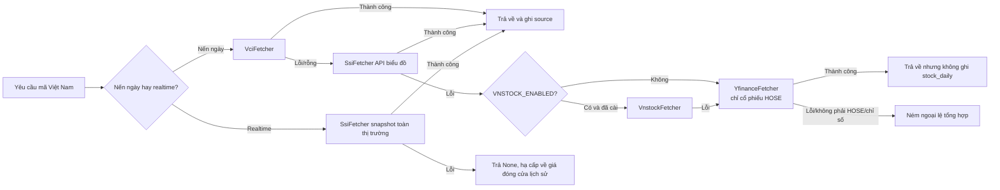

# Độ ổn định nguồn dữ liệu và xử lý sự cố

Tài liệu cho người dùng, người triển khai và người bảo trì: các nguồn dữ liệu thị trường Việt Nam tham gia phân tích và điểm lại thị trường như thế nào, và hệ thống hạ cấp ra sao khi một nguồn lỗi.

Hệ thống chỉ hỗ trợ thị trường Việt Nam (xem [Phạm vi thị trường](market-support.md)). Các nguồn A-share / quốc tế (akshare, efinance, tushare, pytdx, baostock, tencent, tickflow, longbridge, futu, finnhub, alphavantage) đã bị xoá; biến môi trường của chúng bị bỏ qua.

## Trả lời người dùng trong một câu

"Lỗi nguồn dữ liệu" thường là do API công khai bị giới hạn tần suất, thay đổi tạm thời phía upstream hoặc mạng chập chờn, không phải hệ thống chỉ có một nguồn. Chuỗi mặc định VCI → SSI → (vnstock tuỳ chọn) → Yahoo tự chuyển sang nguồn kế tiếp; cả ba nguồn mặc định đều là API công khai, **không cần API key**.

## Ma trận nguồn dữ liệu

| Tình huống | Nguồn | Cách dùng mặc định | Xử lý khi lỗi |
| --- | --- | --- | --- |
| Nến ngày cổ phiếu / kỹ thuật | VCI (Vietcap), SSI iBoard, vnstock (tuỳ chọn), Yahoo (chỉ HOSE) | `DataFetcherManager` thử theo priority: VCI(P0) → SSI(P1) → vnstock(P2, nếu bật) → Yahoo(P4) | Lỗi thì sang nguồn kế; lỗi liên tiếp sẽ ngắt mạch nguồn đó một thời gian ngắn; tất cả đều lỗi thì ném ngoại lệ tổng hợp |
| Giá realtime | SSI iBoard (VCI là lựa chọn thứ hai qua `REALTIME_SOURCE_PRIORITY`), TVSI MQTT (tuỳ chọn) | Snapshot toàn thị trường (HOSE/HNX/UPCoM mỗi sàn một request), tra từng mã trúng cache trong tiến trình | Snapshot lỗi thì trả `None` và hạ cấp về giá đóng cửa lịch sử; một sàn lỗi không ảnh hưởng hai sàn còn lại |
| Nến ngày chỉ số | VCI (Vietcap) | `VNINDEX` / `VN30` / `VN100` / `HNXIndex` / `HNX30` / `HNXUpcomIndex`, dùng cùng API nến ngày với cổ phiếu | Lỗi thì sang SSI. **Yahoo không tham gia** vì không có lịch sử chỉ số Việt Nam |
| Điểm lại thị trường | VCI (chỉ số), SSI (độ rộng thị trường) | `MARKET_REVIEW_REGION=vn` | Một chỉ số lỗi chỉ bỏ qua chỉ số đó; độ rộng lỗi thì báo cáo thiếu khối độ rộng |

## Chuỗi hạ cấp



⚠️ **Đơn vị giá**: nến ngày VCI và snapshot SSI dùng "đồng" (HPG báo `21300`), API biểu đồ SSI và `vnstock` dùng "nghìn đồng" (báo `21.3`); hai nguồn sau được nhân 1000 khi chuẩn hoá. Sai đơn vị **không ném lỗi** mà làm MA, % thay đổi và giá cắt lỗ lệch 1000 lần, vì vậy `tests/test_vn_source_drift.py` kiểm tra độ khớp giá đóng cửa giữa các nguồn và độ lớn tuyệt đối, chạy định kỳ cùng `network-smoke`.

### Vai trò của Yahoo Finance (dự phòng thứ ba)

Yahoo cung cấp dữ liệu Việt Nam qua hậu tố `.VN` và chỉ được gọi khi cả VCI lẫn SSI đều lỗi. Lý do giữ lại: hạ tầng của Yahoo nằm ngoài Việt Nam, che được trường hợp các API công khai trong nước cùng lúc không truy cập được.

Độ phủ đo thực tế (2026-09-21, 20 mẫu ngẫu nhiên mỗi sàn):

| Sàn | Độ phủ | Ghi chú |
| --- | --- | --- |
| HOSE | 20/20 | `HPG.VN`, `FPT.VN`..., giá tính bằng đồng |
| HNX | **0/20** | Mọi kiểu hậu tố (`.HN` / `.HNX` / `.VN` / `.HA`) đều rỗng |
| UPCoM | **0/20** | Chỉ vài mã vốn hoá lớn (ví dụ `MCH.VN`) có dữ liệu |
| Chỉ số | **Không dùng được** | `^VNINDEX.VN` hỏi một năm chỉ trả 1 nến; `^VN30.VN` / `^HNXINDEX.VN` / `^UPCOM.VN` rỗng |

Vì vậy `data_capability_service` chỉ khai báo `kline.daily` cho Yahoo, không khai báo `quote.realtime`, `index.daily` hay `market.overview`; khi hỏi chỉ số Việt Nam, `_convert_stock_code` ném `DataFetchError` ngay mà không gửi request.

⚠️ **Mốc điều chỉnh giá khác nhau nên nến ngày Yahoo không ghi DB**: `save_daily_data` UPSERT theo `(code, date)`, nhưng Yahoo và VCI điều chỉnh quyền khác nhau. Ví dụ MBB (82 phiên): sau 2026-08-11 hai nguồn khớp hoàn toàn, còn trước 2026-07-09 lệch hệ số cố định **1.043938** — đó là bậc thang tại ngày giao dịch không hưởng quyền, không phải nhiễu. Ghi lẫn hai nguồn sẽ tạo khoảng trống giả ~4.4%, làm MA, tỷ lệ khối lượng và hỗ trợ/kháng cự sai lệch mà không báo lỗi. `should_persist_daily_data()` (`data_provider/base.py`) chặn việc ghi này: nến ngày từ Yahoo chỉ phục vụ lần phân tích hiện tại, dựng ngữ cảnh trong bộ nhớ qua `_build_analysis_context_from_daily_df()`.

⚠️ **Đừng đặt `YFINANCE_PRIORITY` trước `SSI_PRIORITY`**: Yahoo thiếu HNX, UPCoM và toàn bộ chỉ số; dùng làm nguồn chính sẽ khiến hàng loạt mã lỗi.

⚠️ **Không có lịch giao dịch**: `exchange-calendars` không có HOSE/HNX/UPCoM; kiểm tra ngày giao dịch chỉ loại thứ Bảy / Chủ nhật (fail-open), nên dịp nghỉ lễ dài vẫn gửi request.

## Hợp đồng chỉ đọc về năng lực dữ liệu

Web/API cung cấp `GET /api/v1/data/overview` (bí danh `GET /api/v1/data/capabilities`) để trình bày năng lực nguồn, chất lượng tập dữ liệu và thứ tự ưu tiên theo một cấu trúc chỉ đọc. Endpoint chỉ đọc cấu hình và snapshot fetcher của `DataFetcherManager`, không gọi API thị trường và không trả về khoá bí mật.

- `providers`: `enabled`, `configured`, `status`, `markets`, `datasets`, `dataset_markets` và cảnh báo không nhạy cảm của từng provider.
- `datasets`: `status/source/fallback_from/stale/warnings` của `quote.realtime`, `kline.daily`, `index.daily`, `market.overview`, `news.events`, `alert.monitor`, `portfolio.account`...
- `priorities`: thứ tự nguồn hiện tại theo từng tình huống.

`unknown` nghĩa là chưa thăm dò lúc chạy, `unconfigured` nghĩa là thiếu cấu hình bắt buộc, `degraded` nghĩa là nguồn ưu tiên trước không dùng được nhưng nguồn sau vẫn phục vụ.

## Cấu hình khuyến nghị

Không cần cấu hình gì để chạy: VCI + SSI là mặc định. Các tuỳ chọn trong `.env.example`:

```env
# Thứ tự priority (số nhỏ hơn được thử trước)
# VCI_PRIORITY=0
# SSI_PRIORITY=1
# Thứ tự nguồn giá realtime (token: ssi / vci)
# REALTIME_SOURCE_PRIORITY=ssi
# vnstock tuỳ chọn: chỉ bật khi chấp nhận giấy phép Personal Use và telemetry của vnstock
# pip install -r requirements-vn-optional.txt
# VNSTOCK_ENABLED=false
```

## Gợi ý thông điệp cho người dùng

| Tình huống | Thông điệp gợi ý |
| --- | --- |
| Một nguồn lỗi nhưng fallback thành công | Lần này dùng nguồn dự phòng, phân tích vẫn tiếp tục; báo cáo ghi rõ nguồn đã dùng. |
| Nhiều nguồn lỗi nhưng còn cache | Nguồn realtime không khả dụng, dùng dữ liệu thành công gần nhất; độ tin cậy kết luận giảm. |
| Mọi nguồn đều lỗi và không có cache | Dữ liệu hiện không khả dụng, vui lòng thử lại sau; kiểm tra kết nối tới `trading.vietcap.com.vn` và `iboard-query.ssi.com.vn`. |

### Ghi chú báo cáo khi thiếu bằng chứng tin tức (đã triển khai)

Báo cáo phân biệt **chưa tìm kiếm tin** với **đã tìm nhưng không có kết quả** và hiển thị cảnh báo tương ứng ở dashboard, brief, báo cáo từng mã, báo cáo ngày, Markdown lịch sử, ảnh chia sẻ và chi tiết báo cáo trên Web; báo cáo tiếng Việt và tiếng Anh dùng câu chữ riêng. Cảnh báo không phụ thuộc đầu ra của mô hình: dù LLM vẫn viết `market_sentiment` / `hot_topics`, hễ tìm kiếm không có kết quả là vẫn cảnh báo.

Căn cứ là `AnalysisResult.news_result_count`:

| Giá trị | Ý nghĩa | Có cảnh báo |
| --- | --- | --- |
| `None` | Chưa tìm kiếm (chưa cấu hình kênh tìm kiếm) | **Có** |
| `0` | Đã tìm nhưng không có kết quả (bị giới hạn, mọi nguồn lỗi...) | **Có** |
| `> 0` | Có tin tức | Không |

Bản ghi mới lưu giá trị ba trạng thái này cùng kết quả phân tích; bản ghi cũ không có trường này được coi là "không rõ" và giữ nguyên cách hiển thị.

## Tài liệu chính thức

- Vietcap (VCI): https://trading.vietcap.com.vn/
- SSI iBoard: https://iboard.ssi.com.vn/
- vnstock (giấy phép): https://vnstocks.com/onboard/giay-phep-su-dung
- Yahoo Finance: https://finance.yahoo.com/
