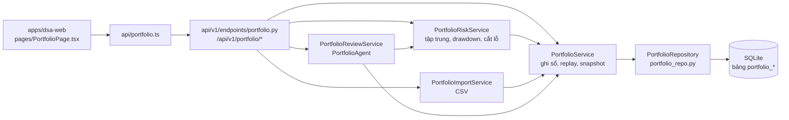
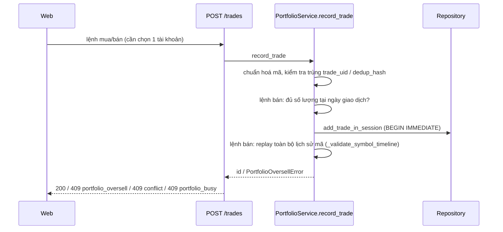

# Workflow Quản lý danh mục

Tài liệu mô tả luồng dữ liệu của trang **Quản lý danh mục** (`/portfolio`): ghi sổ lệnh, dựng snapshot, tính rủi ro, nhập CSV, cảnh báo, và các điểm mà agent/LLM tham gia. Chi tiết về PortfolioAgent xem [agent-workflow.md §8](agent-workflow.md#8-portfolioagent--đánh-giá-danh-mục); cảnh báo danh mục xem [alerts.md](alerts.md).

> Số dòng `file:line` được đối chiếu với code tại thời điểm viết. Nếu lệch, tin vào code.

## 1. Tổng quan

Thị trường duy nhất là Việt Nam (`market=vn`, tiền tệ VND); không có quy đổi ngoại tệ.

## 2. Mô hình dữ liệu (`src/storage.py`)

| Bảng | Vai trò |
| --- | --- |
| `portfolio_accounts` | Tài khoản; xoá = lưu trữ (`is_active=false`), không xoá vật lý |
| `portfolio_trades` | Lệnh mua/bán; duy nhất theo `(account, trade_uid)` và `(account, dedup_hash)` |
| `portfolio_cash_ledger` | Nạp / rút tiền (`in` / `out`) |
| `portfolio_corporate_actions` | `cash_dividend` (cổ tức tiền) và `split_adjustment` (tách / gộp) |
| `portfolio_positions`, `portfolio_position_lots` | **Cache** vị thế và lô FIFO của lần replay gần nhất |
| `portfolio_daily_snapshots` | **Cache** snapshot theo ngày, duy nhất theo `(account, ngày, cost_method)`, có `payload` JSON |

Không có "vị thế hiện tại" lưu cố định: vị thế luôn được dựng lại bằng cách replay toàn bộ sự kiện. Mỗi lần ghi hoặc xoá sự kiện sẽ xoá cache vị thế / lô của tài khoản và các snapshot từ ngày sự kiện trở đi (`_invalidate_account_cache_in_session`).

## 3. Ghi sổ lệnh

- Mọi thao tác ghi chạy trong `portfolio_write_session` (SQLite `BEGIN IMMEDIATE`); khoá DB trả 409 `portfolio_busy`, lỗi trong session thì rollback.
- **Kiểm tra toàn bộ lịch sử mã:** ghi lệnh bán lùi ngày, xoá lệnh mua, ghi hoặc xoá `split_adjustment` đều replay toàn bộ sự kiện của mã đó. Nếu bất kỳ lệnh bán nào sau đó vượt số lượng nắm giữ, thao tác bị từ chối (409 `portfolio_oversell`) và không có gì thay đổi.
- Sổ lệnh đã hỏng từ trước (tạo trước khi có kiểm tra này) vẫn làm `GET /snapshot` trả 400; cần xoá dòng sai để khôi phục.

## 4. Snapshot (`GET /snapshot`)

`PortfolioService.get_portfolio_snapshot` → `_replay_account` cho từng tài khoản:

1. Sắp xếp sự kiện theo ngày; cùng ngày: tiền → sự kiện quyền → lệnh.
2. Giá vốn theo **FIFO** (lô, đơn giá = (giá trị + phí + thuế) / số lượng) hoặc **bình quân** (`avg`).
3. Lãi/lỗ đã thực hiện = tiền bán ròng − giá vốn tiêu thụ. Cổ tức tiền cộng vào tiền mặt; tách/gộp nhân số lượng lô và chia đơn giá.
4. Giá mỗi mã (`_resolve_position_price`): hôm nay thử báo giá realtime trước (trừ khi `include_realtime=false`), rồi giá đóng cửa gần nhất `≤ as_of` trong `stock_daily`. Báo giá realtime đi qua `DataFetcherManager.get_realtime_quote`: tick MQTT TVSI còn mới (≤ `REALTIME_FEED_STALE_SECONDS`) trước, rồi theo `REALTIME_SOURCE_PRIORITY` (FiinTrade đứng đầu khi đã bật, sau đó SSI, VCI). Trong phiên vì vậy là giá MQTT; ngoài phiên feed im lặng nên là giá khớp mới nhất từ FiinTrade PriceDepth. `price_provider` của vị thế ghi nguồn thật (`tvsi_mqtt` / `fiintrade` / `ssi` / `vci`, lấy từ thuộc tính `realtime_provider` mà manager gắn vào quote) thay vì `fallback` như trước.
5. Vốn chủ sở hữu = tiền mặt + giá trị thị trường. Kết quả được ghi lại vào các bảng cache.

Ngữ nghĩa giá:

| Trường hợp | Kết quả |
| --- | --- |
| Có giá | `price_available=true`; `price_stale=true` khi ngày giá cũ hơn **phiên giao dịch hoàn tất gần nhất** (`latest_completed_session_date`) |
| Cuối tuần, giá thứ Sáu | Không stale |
| Trong phiên (trước 14:45), giá phiên trước | Không stale |
| Ngày lễ | Chưa mô hình hoá: giá trước kỳ nghỉ vẫn bị coi là stale |
| Không có giá | `price_available=false`, loại khỏi giá trị thị trường và lãi/lỗ (không dùng giá vốn thay thế), gắn hạn chế `price_unavailable` → `data_quality=partial` ở vị thế, tài khoản và tổng; Web hiện banner "Giới hạn định giá danh mục" |

Giá trên trang Web:

- Tải nhanh với `include_realtime=false` để không bị nguồn realtime chậm chặn màn hình, rồi tự gọi lại `GET /snapshot?include_realtime=true` ở nền và thay snapshot khi có kết quả (lỗi thì giữ bản đang hiển thị).
- Các mã đang nắm giữ được feed MQTT subscribe tự động (xem [alerts.md](alerts.md#cảnh-báo-realtime-theo-tick-feed-mqtt-tvsi)). Tick đến qua SSE `price_update` được ghép vào snapshot ngay trên trình duyệt (`applyLivePrices`): giá, giá trị thị trường, lãi/lỗ chưa thực hiện, tổng tài khoản và tổng danh mục đổi theo, tiền mặt giữ nguyên. Chỉ tick cùng ngày với `as_of` của snapshot được dùng. Bảng vị thế hiện nhãn "Giá realtime (MQTT)" khi có mã đang lấy giá từ feed.
- Ghép giá chỉ để hiển thị: rủi ro, biểu đồ tập trung và snapshot ngày trong DB không đổi cho tới lần tải lại.
- Cần `REALTIME_FEED_ENABLED=true`, `AGENT_EVENT_MONITOR_ENABLED=true` và `TVSI_MQTT_HOST`; thiếu thì trang chỉ có giá từ lần tải realtime (FiinTrade/SSI).

## 5. Rủi ro (`GET /risk`)

`PortfolioRiskService.get_risk_report` dựng lại snapshot rồi tính:

| Khối | Cách tính | Ngưỡng (`.env`) |
| --- | --- | --- |
| `concentration` | Giá trị mỗi mã / tổng giá trị cổ phiếu (không tính tiền mặt) | `PORTFOLIO_RISK_CONCENTRATION_ALERT_PCT` (35) |
| `sector_concentration` | Hiện mọi mã đều `UNCLASSIFIED` (chưa có nguồn ngành VN) → Web hiển thị thay bằng tập trung theo mã | — |
| `drawdown` | Đỉnh-đáy trên `total_equity` của snapshot ngày | `PORTFOLIO_RISK_DRAWDOWN_ALERT_PCT` (15), `PORTFOLIO_RISK_LOOKBACK_DAYS` (180) |
| `stop_loss` | Lỗ % = (giá vốn − giá hiện tại) / giá vốn; "gần" khi ≥ ngưỡng × hệ số; bỏ qua mã thiếu giá | `PORTFOLIO_RISK_STOP_LOSS_ALERT_PCT` (10), `PORTFOLIO_RISK_STOP_LOSS_NEAR_RATIO` (0.8) |
| `decision_signal_risk` | Đếm tín hiệu AI active sell/reduce/alert của mã đang nắm; lỗi thì `available=false` | — |

Drawdown:

- Trước khi tính, `_ensure_drawdown_snapshot_window` bù các snapshot ngày còn thiếu trong cửa sổ, **bỏ qua thứ 7/CN**. Mỗi ngày thiếu là một lần replay đầy đủ, nên lần gọi `/risk` đầu tiên sau khi sửa sổ lệnh lùi ngày có thể chậm.
- Loại cả ngày nếu là ngày không giao dịch hoặc có snapshot thiếu giá; số ngày bị loại trả về ở `drawdown.excluded_points`.
- **Chưa loại trừ nạp/rút tiền:** rút tiền vẫn bị tính như sụt giảm, nạp tiền nâng đỉnh. Cảnh báo dựa trên drawdown **tối đa** nên khi đã vượt ngưỡng sẽ còn bật trong suốt cửa sổ.

## 6. Nhập CSV (`/imports/csv/*`, chỉ có API, Web chưa có màn hình)

`PortfolioImportService` với một parser `generic` (tên cột tiếng Việt / tiếng Anh):

1. `parse`: đọc file (UTF-8, UTF-16 có BOM, cp1258; tên cột chuẩn hoá NFC), ngày không phải ISO đọc theo ngày-trước-tháng (`05/03/2026` = 5/3), số theo quy ước VN (`25.300` = 25300, `25,3` = 25,3, `1.234,5` = 1234,5), chiều lệnh `M`/`Mua` = mua, `B`/`Bán` = bán. Trả preview theo thứ tự file kèm `dedup_hash`.
2. `commit`: ghi theo thứ tự ngày tăng dần (cùng ngày mua trước bán), từng dòng qua `record_trade`; trùng → `duplicate_count`, bán vượt / khoá DB → `failed_count` kèm `line=<dòng>`.

Hạn chế còn lại:

- `dedup_hash` chứa số dòng trong file: cùng một lệnh nằm ở dòng khác trong file xuất khác (ví dụ khoảng ngày khác) sẽ bị nhập trùng. Đổi công thức sẽ làm mất tính idempotent của các lần nhập cũ nên cần thiết kế riêng.
- Không tự nhân giá ×1000 cho file xuất giá theo nghìn đồng.
- Dòng đã nhập sai trước khi sửa parser không tự được sửa; cần xoá và nhập lại.

## 7. Cảnh báo danh mục

`alert_worker.py` đánh giá các rule `target_scope=portfolio_account` qua `portfolio_alerts.py`: `portfolio_stop_loss` (near/breach), `portfolio_concentration`, `portfolio_drawdown`, `portfolio_price_stale`; và `portfolio_holdings` mở rộng thành từng mã đang nắm. Ngữ nghĩa từng loại xem [alerts.md](alerts.md#持仓风险规则).

## 8. Điểm agent / LLM tham gia

| Đường vào | Thành phần | Dùng dữ liệu danh mục thật? |
| --- | --- | --- |
| Nút **Đánh giá danh mục bằng AI** → `POST /ai-review` | `PortfolioReviewService` → `PortfolioAgent` | Có: snapshot + rủi ro + tín hiệu AI mới nhất, tỷ trọng do server tính |
| Nút **Phân tích** một mã đang nắm → `POST /positions/{symbol}/analysis` | Pipeline phân tích thường (legacy hoặc agent) qua task queue | Gián tiếp: `portfolio_context` (số lượng, giá vốn, lãi/lỗ) vào khối `portfolio` của context pack (`analysis_context_builder.py`) |
| Chat `/chat` hoặc single-agent | Tool `get_portfolio_snapshot` | Có, khi agent tự gọi tool; backend Codex không thấy tool này |
| `/ask` 2-5 mã (bot) | `PortfolioAgent` overlay | Không: chỉ ý kiến của các mã vừa phân tích; bot hiện chưa nhận lệnh (`ALL_PLATFORMS = {}`) |
| Tín hiệu AI theo vị thế | `DecisionSignalService` (`holding_only`) | Đọc bảng cache `portfolio_positions`, không replay |

## 9. Hạn chế đã biết

- `GET /snapshot` và `GET /risk` **ghi DB** (cache vị thế, snapshot ngày) dù là request đọc.
- Ngày lễ chưa được mô hình hoá trong lịch giao dịch.
- Drawdown chưa loại trừ nạp/rút tiền.
- Ngành luôn `UNCLASSIFIED`; PortfolioAgent chỉ ước lượng ngành ICB.
- Chưa mô hình hoá T+2 trong sổ lệnh (bán trước khi hàng về vẫn được ghi), lô 100 và thuế cổ tức.
- `date.today()` của service theo giờ máy chủ, không phải giờ Việt Nam.
- Kết quả đánh giá AI không được lưu.
